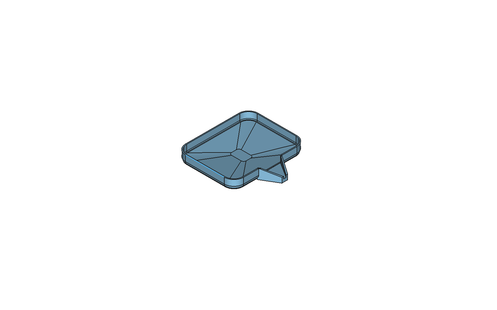
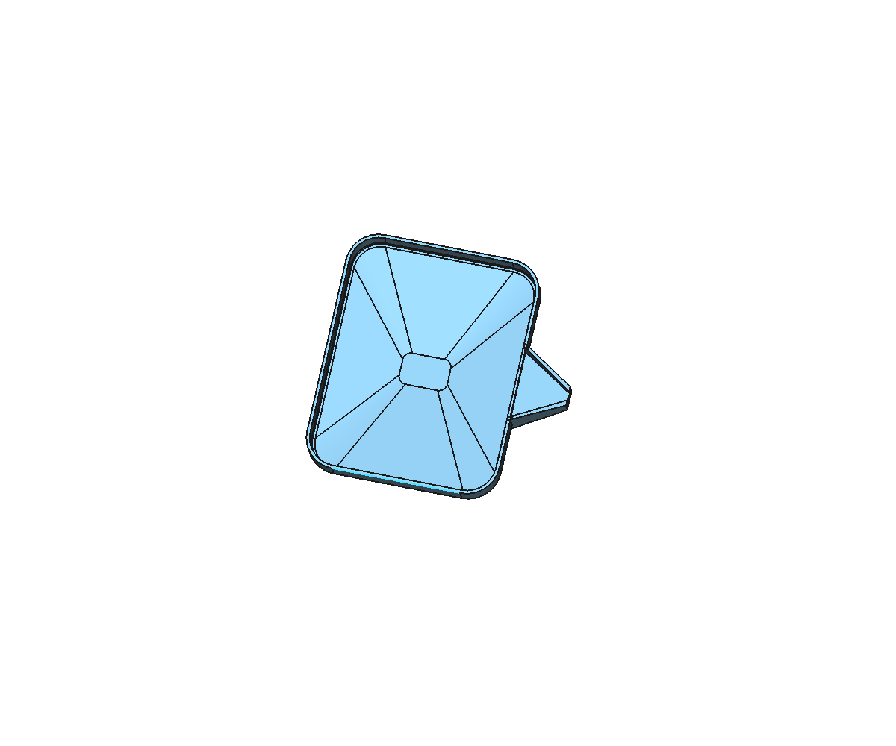

# PetUrineTray 寵物接尿盤

給貓狗採尿用的小盤子：接尿後從側邊漏斗嘴倒入量杯，再用滴管吸取滴在尿液試紙上。

## 特色

- **中央集水凹陷**：內底四周向中央 30×20mm 集水區斜降，放平時尿液集中在中間
- **側邊漏斗嘴**：由盤內約 46mm 收窄到出口約 6mm，嘴底與凹陷外緣齊平，傾斜即可倒入量杯
- **斜口側牆**：嘴部側牆由盤高斜降，倒液時不易沾壁
- **好清洗**：內底四周圓角，無死角
- **免支撐列印**：開口朝上直接列印

## 版本

| 檔案 | 外形 (mm) | 盤緣內深 | 凹陷深度 | 容量 | PETG 用量 |
|---|---|---|---|---|---|
| `PetUrineTray_H12.5.*` | 150 × 150 × 12.5 | 7.5 mm | 3 mm | ≈145 ml | ≈98 g |
| `PetUrineTray_H20.*` | 150 × 150 × 20 | 14 mm | 4 mm | ≈260 ml | ≈119 g |

外形含漏斗嘴：盤體 120 × 150，嘴長 30。壁厚 2 mm。

每個版本提供：

- `.stl`：3D 列印
- `.step`：其他 CAD 軟體
- `.FCStd`：FreeCAD 原始檔（PartDesign 參數化，可直接改尺寸）

## 列印建議

- 材料：PETG（耐尿液、可用溫水＋中性清潔劑清洗，勿沸水消毒）
- 方向：開口朝上，免支撐
- 外壁／底面至少 3 層 perimeter／bottom layer，避免滲漏
- 填充 15% 即可

## 修改尺寸（FreeCAD）

| 特徵 | 可改參數 |
|---|---|
| `Sketch_TrayOutline` / `Pad_Tray` | 盤體長寬、圓角 / 盤高 |
| `Fillet_Bottom` | 底部圓角 |
| `Thickness_Shell` | 壁厚 |
| `Sketch_SpoutOuter` / `Sketch_SpoutChannel` | 漏斗嘴外形 / 內流道 |
| `Sketch_SpoutTaper` | 嘴部側牆斜口 |
| `Pad_FloorFill` / `Sketch_DishTop` / `Sketch_DishSump` | 凹陷深度 / 凹陷外緣 / 中央集水區 |

> 改了盤體外形後，`Fillet_Bottom` 的選邊可能因拓撲命名變動失效，需重新選取底部 8 條邊。

